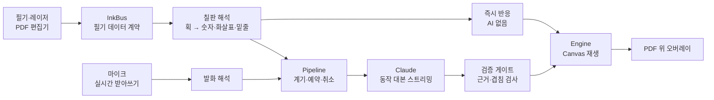

# 살아있는 칠판 · 교수자 (professor)

교수자 화면: 강의 자료(PDF) 위에 필기하고 말하면, AI가 "시간에 따라 변하는 설명"을 알아채 필기 위에서 움직이게 한다.
필기 앱 작업 범위는 [docs/scope.md](docs/scope.md) 참고.

디자인: [Figma - 교수자 필기 화면](https://www.figma.com/design/varfI1eZkbR9f7FQ8DUCLy) (문서 목록, 필기 화면, 모아보기, 모아보기 팝업, 컴포넌트)

## 무엇을 하나

버블 정렬 페이지에 `5 3 8 1`을 써 두고 "5랑 3, 둘이 바뀌겠죠?"라고 말하면, 교수자가 쓴 5와 3이 칠판 위에서 자리를 바꾼다.

- 화살표를 그으면 그 위로 입자가 흐르고, 레이저 포인터로 가리키면 점이 궤적을 따라간다.
- 정렬, 패킷 전송, 혈액 순환, 궤도, 진자, 그래프 평행 이동처럼 과정이 있는 설명을 대상으로 한다.
- **말한 만큼만 움직인다.** "비교해 볼까요?"처럼 결과를 말하지 않은 문장에는 강조만 한다.
- **근거 없는 이동은 하지 않는다.** 말에 나오지 않은 대상을 옮기거나 도착지가 겹치면 보류한다.
- 목표 속도는 행동 후 1초 안 반응이다.

## 동작 방식



| 단계 | 하는 일 | 주요 파일 |
| --- | --- | --- |
| 입력 | 편집기가 `page`·`stroke`·`erase`·`point` 이벤트를 보내고, 마이크는 받아쓰기 엔진으로 들어간다 | `src/screens/Editor.tsx`, `src/lib/inkBridge.ts`, `src/animation/speech.ts`, `src/animation/cloudstt.ts` |
| 칠판 해석 | 획을 객체(글자·선·상자)로 묶고 화살표·밑줄·덧그리기를 가린다. 펜을 쉬면 LLM이 객체의 역할을 정한다 | `src/animation/board.ts`, `src/animation/scene.ts` |
| 계기와 예약 | 입력을 계기(획, 말, 가리키기…)로 바꾸고 짧게 묶은 뒤 AI를 부른다. 새 입력이 오면 낡은 요청을 취소한다 | `src/animation/pipeline.ts` |
| 즉시 반응 | 화살표·가리키기·"흘러/막혀" 같은 확실한 신호는 AI 없이 바로 움직인다 | `src/animation/quick.ts` |
| AI 대본 | 칠판 상태·발화·필기 이미지를 보내고 한 줄에 하나씩 JSON 단계를 받는다 | `src/animation/ai/` |
| 검증 게이트 | 발화에서 대상·이동 의도·부정을 뽑아 근거 없는 동작을 막고, 실측에서 자주 틀린 응답을 바로잡는다(진자 고정점·기울기, 공전, 축 대신 곡선, 그린 화살표 따라가기). 두 수 교환·정렬·패킷 개수·확산·되돌리기는 코드가 직접 계획한다 | `src/animation/grounding.ts` |
| 재생 | 동작 13종(`flow` `send` `stop` `diffuse` `spawn` `move` `rotate` `restore` `color` `scale` `pulse` `fade` `label`)을 실행하고, 움직이는 동안 원본 획은 숨긴다 | `src/animation/engine.ts`, `src/animation/ops.ts` |

## 기술 스택

| 영역 | 사용 |
| --- | --- |
| 화면 | React 19, TypeScript 7, Vite 8, pdf.js(`pdfjs-dist`), lucide-react |
| 저장 | 브라우저 IndexedDB (PDF·필기) |
| 애니메이션 | Canvas 2D 오버레이, `requestAnimationFrame` |
| AI | Anthropic SDK, Claude Haiku 5.5 기본 (Sonnet 5.5 선택 가능), 스트리밍, 시스템 프롬프트 캐시 |
| 받아쓰기 | 기본 OpenAI Realtime(`gpt-live-transcribe`). 브라우저 Web Speech API, Gemini Live(`gemini-3.8-live`)로 바꿀 수 있다. 외부 엔진은 AudioWorklet PCM16 → 서버 WebSocket 프록시 |
| 서버 | 개발: Vite 미들웨어(HTTPS, 접속 코드, API 프록시, 기록 저장). 운영: 의존성 없는 Node 서버 `server/prod.ts` |
| 테스트 | Vitest 5 (단위·실측 회귀), 실측 사례 리플레이 평가 |
| 배포 | Docker(`node:24-alpine`), GHCR, 라즈베리파이 deployd (`linux/arm64`) |

## 실행

```bash
npm install
cp .env.example .env   # ANTHROPIC_API_KEY, OPENAI_API_KEY 채우기
npm run dev            # https://localhost:5173
```

키는 Vite 개발 서버 프록시(`/api/anthropic`)에서만 쓰이고 브라우저로 내려가지 않는다.

같은 와이파이의 다른 기기(태블릿 등)에서는 서버 터미널에 찍히는 `https://<내부망 IP>:5173/?k=<접속 코드>`로 연다.
마이크·음성 인식 때문에 HTTPS(자체 인증서)라 처음 한 번 브라우저 경고를 넘겨야 한다.
접속 코드는 설정 자동 재시작에도 유지된다. `.env.local`의 `ILSABULLAN_DEV_ACCESS_CODE`로 지정하면 프로세스를 다시 켜도 같은 코드를 쓴다. 접속 코드 없이 연 기기는 AI 프록시를 쓸 수 없다 (키 보호).

기본 코드는 새 서버 프로세스에서 만들어진다.
이 Mac에서 HTTPS 없이 보려면 `DEV_HTTP=1 npm run dev`.

받아쓰기 기본값이 OpenAI라 `OPENAI_API_KEY`가 있어야 마이크가 글자를 받는다. 없으면 테스트 패널에서 받아쓰기를 '브라우저 내장'으로 바꾼다. `GEMINI_API_KEY`는 선택이다.

## 명령

| 명령 | 내용 |
| --- | --- |
| `npm run dev` | 개발 서버 (HTTPS, 실측 기록 저장) |
| `npm run typecheck` | 타입 검사 |
| `npm test` | 단위·실측 회귀 테스트. API를 부르지 않는다 |
| `npm run build` | 타입 검사 후 `dist/` 빌드 |
| `npm start` | 운영 서버로 `dist/` 실행 |
| `npm run eval` | 실측 사례를 실제 AI로 재생해 채점. **API 요금이 든다** |
| `node scripts/log-inventory.mjs` | 실측 기록에서 사례로 뽑을 만한 구간 찾기 |
| `node scripts/extract-case.mjs logs/<세션>.jsonl <이름> "<문제>"` | 실측 기록 → `cases/<이름>.json` |
| `node scripts/render-case.mjs <이름>` | 사례의 필기를 그림으로 그려 라벨 붙일 때 보기 |
| `node scripts/watch-submit.mjs` | 테스트 패널의 ‘보내기’를 감시해 한 줄씩 알림 |

`npm run eval`은 환경 변수로 범위를 줄인다.

```bash
EVAL_RUNS=1 EVAL_CASE=real-sort-013822 npm run eval            # 한 사례, 1회
EVAL_MODE=timed EVAL_RUNS=1 EVAL_CASE=real-sort-013822 npm run eval  # 원래 시간 간격으로 재생
```

기본은 모든 라벨된 사례 × 3회, 통과 기준 90%(`EVAL_MIN_PASS`). 보고서는 `logs/eval-*.md`에 남는다.

## 화면

- 문서 목록에서 PDF를 올리고 차시를 연다. 처음 열면 데모 자료 두 개(`public/demo/`: 버블 정렬·평행이동·TCP·진자 4쪽 강의, 버블 정렬 정리)가 미리 들어간다. 브라우저마다 한 번만 넣고, 지운 자료는 다시 넣지 않는다 (`src/lib/demo.ts`).
- 차시를 열면 마이크가 바로 켜진다. 끄는 것은 테스트 패널의 마이크 버튼.
- 필기 화면 왼쪽은 PDF 편집기, 그 페이지 위에 애니메이션이 겹쳐 그려진다.
- 오른쪽은 애니메이션 테스트 패널(대본, 말하기, 실험 설정, 측정). 상단의 플라스크 버튼으로 켜고 끈다.

## 구조

| 경로 | 내용 |
| --- | --- |
| `src/screens/LectureList.tsx` | 차시 목록, PDF 업로드 |
| `src/screens/Editor.tsx` | 필기 화면 (도구 모음, 페이지 이동, 확대, 실행 취소, 저장, 애니메이션 연결) |
| `src/components/PageCanvas.tsx` | 한 페이지의 PDF·필기·레이저 그리기와 펜 입력 |
| `src/components/Overview.tsx` | 모아보기 |
| `src/lib/db.ts` | 브라우저 저장 (IndexedDB) |
| `src/lib/demo.ts` | 데모 자료 미리 넣기 |
| `public/demo/` | 데모용 PDF |
| `src/lib/inkBridge.ts` | 편집기 필기 → 애니메이션 계약 좌표 변환 |
| `src/shared/ink.ts` | **필기 데이터 계약** (PDF 편집기 ↔ 애니메이션 레이어) |
| `src/shared/bus.ts` | 두 쪽을 잇는 이벤트 통로 `InkBus` |
| `src/animation/` | 애니메이션 레이어: 필기 해석, 즉시 반응, AI 호출, 재생 |
| `src/evals/` | 실측 사례 리플레이와 채점 (`npm run eval`) |
| `src/dev/` | 테스트 패널, 대본(데모 주제 4개: TCP·버블 정렬·진자·그래프 평행이동), 테스트 기록 |
| `src/testboard/` | 예전 테스트용 필기 캔버스 (지금은 화면에 쓰지 않음) |
| `server/` | 접속 코드, 기록 저장소, 운영 서버(`prod.ts`) |
| `scripts/` | 실측 기록 → 사례 도구 |
| `cases/` | 실측에서 뽑은 평가 사례 |
| `docs/` | 작업 범위, 보정 기록, 분석·설계 문서 |

## 편집기와 애니메이션 연결

1. `main.tsx`에서 `InkBus` 하나를 만들고 `new Pipeline(bus)`로 애니메이션 쪽을 먼저 연결한다.
2. 편집기는 페이지를 열 때 `page`(PDF 글자 포함), 획을 쓰거나 지우거나 실행 취소할 때 `stroke`·`erase`, 레이저 포인터는 `point`를 보낸다.
   좌표는 페이지 폭을 1280으로 맞춘 페이지 좌표다 (애니메이션 쪽 크기 기준이 1280 칠판에 맞춰져 있음).
3. `bus.onRequest()`로 `hideStrokes`를 받아 해당 획을 잠시 숨긴다. 애니메이션이 그 획을 대신 움직여 그린다.
4. 페이지 캔버스 바로 위에 같은 크기로 `<AnimationOverlay pipeline={pipeline} />`를 겹친다. 흰 종이용 색(`engine.paper`)으로 그린다.

## 속도 (목표: 행동 → 1초 이내 반응)

- 즉시 반응: 화살표·덧그리기·가리키기·"흘러/막혀" 같은 신호는 AI 없이 바로 움직인다.
- AI 반응: Haiku 5.5, 생각 끔, 스트리밍. 완성된 JSON 단계의 동작을 함께 검증한 뒤 재생한다. 시스템 프롬프트는 캐시하고 페이지를 열 때 미리 데운다.
- 측정 패널에서 설정별 중앙값·90%·1초 이내 비율을 보고 CSV로 저장할 수 있다.

## 개선 순환

정확도는 실제 수업처럼 써 본 기록으로 고친다.

1. `npm run dev`로 열고 테스트 패널에서 대본을 골라 실제로 필기하며 말한다.
2. AI 반응마다 ✓/✗(메모)를 남기고 ‘보내기’를 누른다. ‘기록 저장 확인됨’을 본 뒤 탭을 닫는다.
3. `log-inventory`로 구간을 고르고 `extract-case`로 사례를 뽑는다. `render-case` 그림을 보며 손글씨 정답(`read`)과 발화 뒤 기대 결과(`checks`)를 채운다.
4. 고친 뒤 `npm test`, 필요하면 `npm run eval`로 확인한다.

규칙:

- 사례는 실측 기록에서만 뽑는다. 직접 지어낸 필기·발화로 사례를 만들지 않는다.
- 모호한 발화의 의도는 정답으로 추측하지 않는다.
- `npm run eval`은 검토된 손글씨 값을 넣어 주므로 실제 손글씨 판독·마이크 정확도 평가가 아니다. 한 번의 통과를 일반 정확도로 해석하지 않는다.
- `.env`, `logs/`는 커밋하지 않는다.

자세한 실행 규칙과 평가의 의미는 [docs/CALIBRATION.md](docs/CALIBRATION.md).

## 문서

| 문서 | 내용 |
| --- | --- |
| [docs/scope.md](docs/scope.md) | 교수자 필기 파트 작업 범위 |
| [docs/CALIBRATION.md](docs/CALIBRATION.md) | 실측 보정 규칙, 평가 방법과 결과 |
| [docs/ACCURACY_ANALYSIS.md](docs/ACCURACY_ANALYSIS.md) | 실측 정확도 저하 원인 분석 |
| [docs/recognition-redesign.md](docs/recognition-redesign.md) | 인식과 실행 분리 설계 (구현 전 제안) |
| [docs/recognition-implementation-plan.md](docs/recognition-implementation-plan.md) | 위 설계의 실행 계획 (미구현) |

## 배포

라즈베리파이 deployd로 배포한다 (`deploy.json`, `Dockerfile`). deployd는 `ghcr.io/hurdoo/` 이미지만 받으므로 이미지는 포크 `HURDOO/professor`에 연결된 `ghcr.io/hurdoo/ilsabullan-professor`에 올린다. 주소는 https://ilsabullan-professor.app.hurdoo.kr/?k=<접속 코드>.

- 운영 서버는 `server/prod.ts` (`npm start`). 의존성 없이 `dist/`를 내주고 `/healthz`, `/api/status`, `/api/anthropic/*`, `/api/stt/<업체>`를 처리한다.
- 공개 주소라서 `/api/*`는 `?k=<접속 코드>`로 한 번 연 기기만 쓸 수 있다.
- 값은 deployd 대시보드 Secrets에만 넣는다. 필수: `ILSABULLAN_ACCESS_CODE`(공백 없는 6~128자). AI와 기본 받아쓰기에 `ANTHROPIC_API_KEY`, `OPENAI_API_KEY`가 필요하다(deployd에는 선택 항목으로 등록돼 있어 빠져도 배포는 된다). `GEMINI_API_KEY`는 선택.
- 테스트 기록(`/api/log`)과 원본 녹음은 개발 서버에서만 저장된다.

## 실측 기록

`npm run dev`에서 필기·음성 인식 결과·AI 입력/응답·요청 상태를 `logs/<세션>.jsonl`에 저장한다. 이미지는 `logs/<세션>/`에 따로 저장한다. 마이크를 켠 동안의 음성 원본은 `logs/<세션>/audio-<녹음번호>.webm`에 5초 조각을 이어 붙여 저장하고, jsonl의 `audio` 기록에 조각별 시각(`t0`~`t1`, final·interim의 `t`와 같은 시계)을 남긴다. 발화 위치는 `발화 t - audio-start의 t0`초다. 인식기가 주는 대안 후보는 `speech` 기록(`event: alternatives`)에 남는다. 화면의 기록 상태는 서버의 저장 확인을 기준으로 표시하며, ‘보내기’의 저장 건수도 확인된 제출만 센다. 저장 실패 시 큐를 유지하고 1초마다 재시도하며, 같은 기록의 재전송은 서버에서 중복 제거한다.

브라우저 대기열은 메모리에 있으므로 **닫거나 새로고침하기 전 ‘기록 저장 확인됨’을 확인**한다. 페이지 종료 시의 추가 전송은 최선의 시도이며, 큰 이미지나 연결 장애가 있으면 미확인 기록을 보장하지 못한다. 개발 서버 전용 기능이며 배포 빌드에서는 자동 기록하지 않는다.

측정 요약의 중앙값·90%·1초 이내 비율은 첫 동작 시각이 관측된 요청만 대상으로 한다. 중단·오류·무반응·보류·진행 중 건수를 함께 확인한다. 무반응은 의도된 결과일 수도 있으므로 전체 요청 대비 정확도나 성공률로 해석하지 않는다. 확정되지 않은 ‘말 중’ 요청은 집계에서 제외한다. 음성 종료 시각은 인식 이벤트로 추정한 값이고 첫 동작 시각은 실행 시각이므로, 실제 음향 종료부터 화면 표시까지를 직접 측정한 값은 아니다.

요청 로그는 `request-start`와 `request-update`로 진행 상태를 남기고, 기존 `request` 이벤트는 완료 시 입력·응답과 함께 남긴다. 같은 요청의 최신 측정값은 `rec.id`로 연결해 마지막 상태를 사용한다. CSV에는 종료 시각·피드백·실제 모델·전체 설정도 포함된다.

원격 기록 저장에 인증 만료(403)가 표시되면 원래 탭을 유지한 채 같은 브라우저의 새 탭에서 최신 `?k=…` 주소를 연다. 쿠키가 갱신되면 원래 탭에서 대기 기록을 자동 재전송한다.
