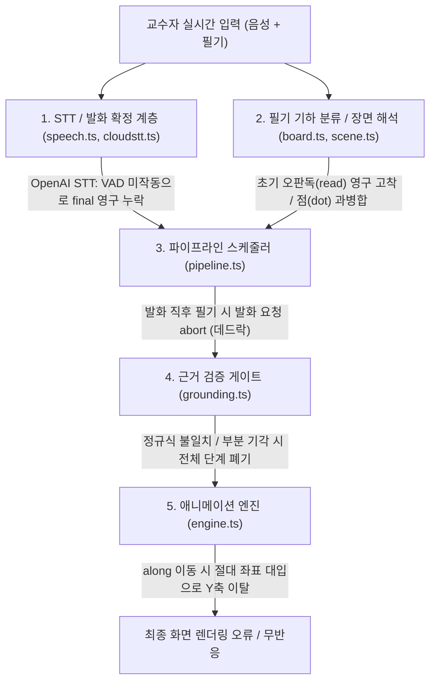

# 정확도 저하 원인 분석 및 개선 제안서

본 문서는 `ilsabullan-professor` 프로젝트의 전체 파이프라인([`src/animation/`](file:///Users/hurdoo/coding/projects/ilsabullan-professor/src/animation/pipeline.ts))과 실측 세션 로그(`logs/*.jsonl`), 채점 보고서(`logs/eval-*.md`)를 전수 분석하여 도출한 **정확도 저하의 5대 핵심 원인**과 **코드 수준의 구체적인 개선안**을 정리한 문서입니다.

---

## 1. 요약: 왜 체감 정확도가 크게 떨어지는가?

> [!IMPORTANT]
> `docs/CALIBRATION.md`의 98% 통과 기록은 **① 손글씨 정답 라벨(`read`)을 강제 주입하고, ② 필기가 모두 끝난 뒤 발화만 순차 재생하며, ③ 버블 정렬 1개 도메인만 평가한 결과**입니다.
> 실제 라이브 사용 환경(`logs/20261101-035007-hu0x.jsonl` ~ `20261101-050449-bv7s.jsonl`)에서는 아래 5가지 병목이 연쇄적으로 발생하며 정상 동작의 상당수가 차단되거나 왜곡되고 있습니다.



| 구분 | 핵심 문제 | 주요 발생 파일 | 실측 로그 근거 |
| :--- | :--- | :--- | :--- |
| **1. 요청 스케줄링** | 말한 직후 필기하면 확정 발화(`말`) 요청이 취소되고, 뒤이은 필기(`획`) 요청은 이동 권한이 없어 **아무 동작도 실행되지 않는 데드락** 발생 | [`pipeline.ts`](file:///Users/hurdoo/coding/projects/ilsabullan-professor/src/animation/pipeline.ts#L276-L382) | `043036-c0e4` (n=95), `050404-7545` (n=261, 361, 370) |
| **2. 음성 인식 (STT)** | OpenAI 실시간 STT에서 VAD 임계값(500) 미달 시 `commit`/`final`이 **0회** 발생하여 모든 `move`가 `"말이 아직 확정되지 않음"`으로 100% 보류됨 | [`cloudstt.ts`](file:///Users/hurdoo/coding/projects/ilsabullan-professor/src/animation/cloudstt.ts#L66-L91) | `050449-bv7s` (n=345~736, `interim` 329회 중 `final` 0회) |
| **3. 엔진 좌표 계산** | 그린 객체를 `along`(화살표 등)으로 이동시킬 때 **상대 변위(delta)가 아닌 화살표의 절대 좌표로 중심을 이동**시켜 Y축 이탈 발생 | [`engine.ts`](file:///Users/hurdoo/coding/projects/ilsabullan-professor/src/animation/engine.ts#L302-L316) | `035007-hu0x` (n=220), `040451-33md` (n=300, 466, 812), `050449-bv7s` (n=226) |
| **4. 휴리스틱 검열** | 좁은 동사 정규식, `role: 'drawing'` 선의 `flow` 차단, **연산 1개 기각 시 전체 응답 단계 폐기**, 대명사 발화 시 숫자 이동 차단 | [`grounding.ts`](file:///Users/hurdoo/coding/projects/ilsabullan-professor/src/animation/grounding.ts#L94-L115), [`pipeline.ts`](file:///Users/hurdoo/coding/projects/ilsabullan-professor/src/animation/pipeline.ts#L568-L580) | `041959-k1lc` (n=502, 948), `050449-bv7s` (n=177~178), `040724-4r6r` (n=1187) |
| **5. 필기 분류·OCR** | 미완성 글자·칸 구분선의 첫 잘못된 판독값(`read`)을 **영구히 덮어쓰지 않음(`!o.read`)**, 연속으로 찍은 입자 점(`dot`)들을 하나의 거대 `mark`로 합침 | [`board.ts`](file:///Users/hurdoo/coding/projects/ilsabullan-professor/src/animation/board.ts#L434-L469), [`pipeline.ts`](file:///Users/hurdoo/coding/projects/ilsabullan-professor/src/animation/pipeline.ts#L476-L483) | `043036-c0e4` (n=235), `035007-hu0x` (n=1051), `050404-7545` (n=70~197) |

---

## 2. 영역별 상세 문제점 및 코드 개선 제안

### 문제 1: 말과 필기가 겹칠 때 확정 발화가 취소되는 스케줄링 데드락

#### 현상 및 원인
1. [`Pipeline.run`](file:///Users/hurdoo/coding/projects/ilsabullan-professor/src/animation/pipeline.ts#L382)은 새 트리거가 실행될 때 무조건 `this.abortInflight('중단(새 입력)')`을 호출합니다.
2. 교수자가 *"이걸 오른쪽으로 2만큼 옮기면"*이라고 말한 직후(확정 발화 요청 `phase: 'final'` 진행 중) 칠판에 점이나 화살표, 글자를 그리면 80ms 뒤 [`handleInk`](file:///Users/hurdoo/coding/projects/ilsabullan-professor/src/animation/pipeline.ts#L256-L282)가 스케줄링한 `획` 트리거(`phase: 'ink'`)가 실행되면서 **진행 중이던 확정 발화 요청을 취소**해 버립니다.
3. 이어서 실행된 `획` 요청은 프롬프트에 방금 한 말이 `최근 발화`로 들어가 있어서 AI가 올바르게 `move` 동작을 생성하더라도, `trig.grounding.phase === 'ink'`이기 때문에 [`rejectUngrounded`](file:///Users/hurdoo/coding/projects/ilsabullan-professor/src/animation/grounding.ts#L113)의 아래 규칙에 걸려 무조건 기각됩니다:
   ```ts
   if (g.phase === 'ink' && ops.some((op) => !['pulse', 'color', 'flow'].includes(op.v)))
     return '필기만으로 다음 과정을 실행할 수 없음'
   ```
4. 또한 [`consume`](file:///Users/hurdoo/coding/projects/ilsabullan-professor/src/animation/pipeline.ts#L586)의 `validate` 콜백은 `this.engine.layoutKey() !== expectedLayout`을 검사하는데, [`Engine.layoutKey`](file:///Users/hurdoo/coding/projects/ilsabullan-professor/src/animation/engine.ts#L140-L145)가 칠판의 **모든 객체(`this.board.objs`)의 ID·시각·획 수**를 직렬화합니다. 즉 AI 요청이 날아간 뒤 교수자가 전혀 무관한 곳에 밑줄이나 점을 하나만 찍어도 `layoutKey()`가 바뀌어 도착한 AI 응답 전체가 `"요청 이후 칠판 배치가 바뀜"`으로 폐기됩니다 (`024015-b43w` n=102, `040724-4r6r` n=1240, `041959-k1lc` n=1072).

#### 🛠 개선 제안
1. **확정 발화(`phase: 'final'`) 보호 및 권한 승계**:
   * `this.inflight?.rec.kind === '말'`(확정 발화 요청)이 진행 중일 때 들어오는 단순 필기(`획`, `덧그리기` 등)는 진행 중인 발화 요청을 `abortInflight`하지 않고 `this.pending`으로 대기시키거나,
   * 아직 이동으로 소비되지 않은 최근 확정 발화(예: 5초 이내)가 있다면 필기 트리거가 실행될 때도 해당 발화의 `grounding`(`phase: 'final'`, `move`, `targets`)을 병합하여 승계하도록 수정합니다.
2. **`layoutKey()` 검사를 전체 보드가 아닌 '조작 대상 객체' 기준으로 축소**:
   * 무관한 획이 추가되었다고 응답을 버리지 않도록, 해당 단계(`validOps`)가 실제로 참조하는 객체(`op.id`, `op.to`, `op.along`)가 지워졌거나 이미 다른 위치로 이동했는지만 검사하도록 [`Engine.layoutKey`](file:///Users/hurdoo/coding/projects/ilsabullan-professor/src/animation/engine.ts#L140-L145)를 대상 객체 한정 검사로 변경합니다.

---

### 문제 2: OpenAI 실시간 STT의 발화 미확정(`final` 누락) 및 음성 오인식

#### 현상 및 원인
1. **OpenAI STT `final` 영구 누락 (`050449-bv7s.jsonl` n=345~736)**:
   * [`RAW_AUDIO`](file:///Users/hurdoo/coding/projects/ilsabullan-professor/src/animation/cloudstt.ts#L27) 설정에서 `autoGainControl: false`로 마이크 게인을 꺼둔 상태에서, [`Vad.push`](file:///Users/hurdoo/coding/projects/ilsabullan-professor/src/animation/cloudstt.ts#L74-L90)는 `const voice = level > Math.max(this.floor * 2.5, 500)`으로 음성을 판별합니다.
   * 마이크 입력 볼륨이 작아 `rms(pcm)`이 `500`을 넘지 않으면 `this.speaking`이 절대 `true`가 되지 않으며, [`sendSetup`](file:///Users/hurdoo/coding/projects/ilsabullan-professor/src/animation/cloudstt.ts#L229)에서 `turn_detection: null`로 서버 VAD까지 꺼놓았기 때문에 `input_audio_buffer.commit`이 영원히 전송되지 않습니다.
   * 반면 `gpt-live-transcribe`는 `delta` 이벤트를 계속 보내므로 `onInterim`만 수백 번 호출되고 `onFinal`은 단 한 번도 호출되지 않습니다.
   * 이로 인해 내내 `phase: 'preview'` 상태가 유지되어 모든 `move`가 `"말이 아직 확정되지 않음"`으로 기각되고, `actionSeq`가 고정되어 `"이미 반영한 발화의 동작"` 거절만 반복됩니다.
2. **숫자·수식·도메인 용어 ASR 오인식**:
   * 브라우저 STT 사용 시 `"5랑 3"` → `"오랑사"` / `"우와 팜"` / `"우와 삼"`, `"8과 1"` → `"815"` / `"8일"`, `"y = (x - 2)²"` → `"와인은 X 102의 제곱"` 등으로 변환됩니다.
   * [`mentionedValues`](file:///Users/hurdoo/coding/projects/ilsabullan-professor/src/animation/grounding.ts#L20-L28)는 정확한 숫자나 한글 수사(`영~구`) 뒤의 제한된 조사만 매칭하므로, `"8일"`(숫자 `8` 하나만 추출됨)이나 `"우와 삼"`(숫자 `3` 하나만 추출됨)에서 비교/이동 쌍을 찾지 못합니다.

#### 🛠 개선 제안
1. **OpenAI STT에 서버 VAD 활성화 또는 텍스트 유휴 타이머(Idle Flush) 추가 ([`cloudstt.ts`](file:///Users/hurdoo/coding/projects/ilsabullan-professor/src/animation/cloudstt.ts#L218-L312))**:
   * OpenAI Realtime Transcription 세션에서 자체 에너지 VAD 대신 검증된 서버 VAD(`turn_detection: { type: 'server_vad', threshold: 0.5, silence_duration_ms: 600 }`)를 사용하거나,
   * Gemini 핸들러([`onGemini`](file:///Users/hurdoo/coding/projects/ilsabullan-professor/src/animation/cloudstt.ts#L328-L330))와 동일하게 `conversation.item.input_audio_transcription.delta` 수신 후 700~800ms 동안 추가 `delta`가 없거나 문장 종결 어미(`요.`, `다.`, `죠?`)가 완성되면 즉시 `input_audio_buffer.commit` 및 로컬 `onFinal`을 호출하는 폴백 타이머를 추가합니다.
   * `Vad.push`의 최소 임계값도 `500`에서 `150` 수준으로 낮추고 초기 `floor`를 실제 무음 구간에 빠르게 적응하도록 수정합니다.
2. **`preview` 단계의 `commitKey` 충돌 해결 ([`pipeline.ts:340-341`](file:///Users/hurdoo/coding/projects/ilsabullan-professor/src/animation/pipeline.ts#L340-L341), [`pipeline.ts:584`](file:///Users/hurdoo/coding/projects/ilsabullan-professor/src/animation/pipeline.ts#L584))**:
   * `move`가 없는 강조(`pulse`/`color`) 연산의 `commitKey`를 `${grounding.id}:${i}`(단계 인덱스 `0`)로만 만들면 한 발화 중 첫 `pulse` 이후 다른 객체를 `pulse`하는 것도 모두 막힙니다. `commitKey`에 대상 객체 ID와 연산 종류(`JSON.stringify(validOps.map(o => [o.v, 'id' in o ? o.id : o.along]))`)를 포함시켜 다른 대상에 대한 강조는 정상 재생되게 합니다.
3. **칠판 위 값(`board.values()`)과 강의 자료(`page.text`) 기반 발화 정규화 ([`grounding.ts`](file:///Users/hurdoo/coding/projects/ilsabullan-professor/src/animation/grounding.ts#L20-L28))**:
   * 칠판에 실제로 적혀 있는 숫자 조합(예: `5, 3, 8, 1`)을 알고 있으므로, 발화 내 동음이의어/유사 발음(`우와/오가/월화` → `5와/5가`, `사/삼` → `3`, `판/파리/팔일/8일/815` → `8과 1` 등)을 현재 칠판의 `values()` 후보군과 대조하여 매칭하는 퍼지(fuzzy) 매칭을 추가합니다.

---

### 문제 3: `move` 연산의 좌표 계산 버그 ("포물선이 Y축으로도 이동하는 문제")

#### 현상 및 원인
그래프 평행이동(`graphshift`) 테스트에서 사용자가 가장 많이 실패 피드백을 남긴 문제입니다 (`035007-hu0x` n=220, `040451-33md` n=300/466/812, `050449-bv7s` n=226). 원인은 3가지입니다:

1. **`along` 이동 시 상대 변위(Delta)가 아닌 경로의 절대 좌표로 객체를 끌어당김 ([`engine.ts:302-316`](file:///Users/hurdoo/coding/projects/ilsabullan-professor/src/animation/engine.ts#L302-L316), [`engine.ts:389-401`](file:///Users/hurdoo/coding/projects/ilsabullan-professor/src/animation/engine.ts#L389-L401))**:
   ```ts
   // 현재 코드 (engine.ts:306-314, 397-398)
   const base = sp ? { x: 0, y: 0 } : { x: from.x - this.offset(op.id).x, y: from.y - this.offset(op.id).y }
   a.path = { pts, t0: now, dur: op.dur, base }
   a.gx = end.x - base.x
   a.gy = end.y - base.y
   // tick() 내부:
   a.dx = q.x - a.path.base.x
   a.dy = q.y - a.path.base.y
   ```
   * `spawn`으로 새로 만든 점(`sp`)이 선을 타고 흐를 때는 점의 위치가 선 위의 점 `q`가 되는 것이 맞습니다.
   * 하지만 **이미 칠판에 그려진 큰 도형/곡선(예: 포물선 `o4`, 중심 `(530, 268)`)**을 옆이나 아래에 그린 화살표(`along: "o5"`, 시작점 `(697, 329)` → 끝점 `(881, 331)`)를 따라 옮길 때, 현재 코드는 포물선의 중심을 화살표의 절대 위치 `(697, 329) → (881, 331)`로 옮겨버립니다.
   * 그 결과 포물선이 오른쪽으로만 가는 것이 아니라 화살표가 그려진 Y 좌표(`329`)로 **60px 이상 아래(Y축 방향)로 뚝 떨어지며 이동**합니다.
2. **화살표 머리(V자 획)가 선의 대표 점(`pts`)을 왜곡 ([`board.ts:285, 321`](file:///Users/hurdoo/coding/projects/ilsabullan-professor/src/animation/board.ts#L318-L322))**:
   * 한 획으로 화살표를 그리거나 장면 해석에서 화살표로 재분류할 때 끝부분의 화살표 날개 획까지 `pts`에 포함되면(`(697,329)→(881,331)→(865,353)`), 끝점이 날개 끝(`y=353`)이 되어 이동 막바지에 대각선으로 한 번 더 꺾입니다.
3. **자기 자신을 `along`으로 참조 (`{"v":"move","id":"o4","along":"o4"}`) 및 상대 이동(`by`) 부재**:
   * [`validateStep`](file:///Users/hurdoo/coding/projects/ilsabullan-professor/src/animation/engine.ts#L165-L171)에서 `op.id === op.along`을 막지 않아, AI가 포물선 `o4`를 자기 자신(`along: "o4"`)을 따라 이동시켜 포물선이 U자 궤적을 그리며 요동칩니다 (`33md` n=466, 812).
   * 또한 화살표 없이 말로만 *"오른쪽으로 2만큼 옮기면"*이라고 했을 때, [`ops.ts`](file:///Users/hurdoo/coding/projects/ilsabullan-professor/src/animation/ops.ts)에 상대 변위(`by: [dx, dy]`) 연산이 없어 AI가 x축 객체(`to: "o3"`)나 임의의 `[x, y]`를 찍으면서 원래 Y 좌표가 틀어집니다 (`33md` n=300).

#### 🛠 개선 제안
1. **그린 객체(`BoardObj`)의 `along` 이동을 '벡터 평행이동(Relative Translation)'으로 변경 ([`engine.ts`](file:///Users/hurdoo/coding/projects/ilsabullan-professor/src/animation/engine.ts#L302-L316))**:
   * 이동 대상이 `spawned` 객체(또는 작은 `dot`/가리키기 궤적 `t…`)가 아니라 **원래 칠판에 있던 도형·선·글자(`BoardObj`)**이고 화살표/선(`o…`)을 `along`으로 삼는 경우, 경로의 첫 점 `pts[0]`을 기준으로 한 변위(`(q.x - pts[0].x, q.y - pts[0].y)`)를 시작 위치 `from`에 더하도록 수정합니다:
   ```ts
   // 개선안: 그린 객체가 화살표(o...)를 따라 이동할 때는 화살표의 변위 벡터만큼만 평행이동
   const relative = !sp && !op.along.startsWith('t')
   const startOffset = this.offset(op.id)
   const relPts = relative
     ? pts.map((p) => ({ x: from.x + (p.x - pts[0].x), y: from.y + (p.y - pts[0].y) }))
     : pts
   ```
2. **자기 자신 `along` 금지 및 `by: [dx, dy]` 연산 추가 ([`ops.ts`](file:///Users/hurdoo/coding/projects/ilsabullan-professor/src/animation/ops.ts), [`engine.ts`](file:///Users/hurdoo/coding/projects/ilsabullan-professor/src/animation/engine.ts#L165-L171))**:
   * `validateStep`에 `if (op.along === op.id) return '자기 자신을 경로로 이동할 수 없음'`을 추가합니다.
   * `MoveOp`에 `by?: [number, number]`(예: `{"v":"move","id":"o4","by":[120,0],"dur":700}`)를 추가하고 시스템 프롬프트에 *"평행이동처럼 현재 위치에서 일정 거리만큼 옮길 때는 `by:[dx,dy]`(수평 이동이면 `dy:0`)를 쓴다"*고 명시합니다.

---

### 문제 4: 과도한 휴리스틱 검열(`grounding.ts` & `pipeline.ts`)로 인한 정상 동작 기각

#### 현상 및 원인
1. **부분 기각(Partial Rejection)이 전체 응답을 폐기함 ([`pipeline.ts:568-580`](file:///Users/hurdoo/coding/projects/ilsabullan-professor/src/animation/pipeline.ts#L568-L580))**:
   * 현재 [`consume`](file:///Users/hurdoo/coding/projects/ilsabullan-professor/src/animation/pipeline.ts#L568)은 한 단계가 `reject()`되면 `rec.rejected`를 증가시키고, 상단 가드 `if (gated || rec.rejected || !ps.closed || seen.has(i)) return`에 의해 **같은 응답의 다음 줄(다음 단계)을 아예 파싱·실행하지 않고 버립니다.**
   * 또한 한 단계(`ps.ops`) 안에 여러 연산(예: `pulse` + `flow` + `move`)이 있을 때, 부수적인 `flow`나 `stop` 하나만 `rejectUngrounded`에 걸려도 그 단계 전체가 통째로 날아갑니다 (`bv7s` n=178, `4r6r` n=1187).
2. **`isFlowPath`와 `g.flow`의 과도한 제한 ([`grounding.ts:71, 110`](file:///Users/hurdoo/coding/projects/ilsabullan-professor/src/animation/grounding.ts#L110), [`board.ts:245-258`](file:///Users/hurdoo/coding/projects/ilsabullan-professor/src/animation/board.ts#L245-L258))**:
   * [`board.isFlowPath`](file:///Users/hurdoo/coding/projects/ilsabullan-professor/src/animation/board.ts#L250)는 `if (o.role) return o.role === 'arrow' || o.role === 'connector'`로만 제한합니다. 장면 해석기(`SceneParser`)는 지구 공전 궤도, 혈관, 신경 축삭, 강물, 그래프 곡선을 `role: 'drawing'`으로 분류하기 때문에, 이 선들 위에서 일어나는 모든 `flow`가 `"흐름의 근거 또는 연결 경로가 없음"`으로 기각됩니다 (`k1lc` n=502, 948).
   * `g.flow` 정규식(`grounding.ts:71`)에도 `돌다/공전/회전/켜지/꺼지/작동/전류/신호/임금/노동/증발/내려/건너가` 등의 표현이 빠져 있어 물리·지구과학·생명·경제 교안에서 `flow`가 대거 차단됩니다.
3. **대명사·조건 발화 시 숫자 이동 차단 ([`grounding.ts:101-108`](file:///Users/hurdoo/coding/projects/ilsabullan-professor/src/animation/grounding.ts#L101-L108))**:
   * 칠판에 숫자로 읽힌 객체가 이동할 때 `g.targets`가 비어 있으면 `"이동할 값이 특정되지 않음"`으로 기각합니다.
   * 교수자가 *"옆끼리 비교해서 큰 걸 뒤로 보내요"*, *"더 크니까 바꾸고"*, *"스택에 차례대로 넣어요"*처럼 숫자를 직접 다시 호명하지 않고 지시하면 `g.targets`가 `[]`가 되어 정상적인 이동이 모두 차단됩니다 (`hu0x` n=991, 1048; `33md` n=1591).

#### 🛠 개선 제안
1. **연산 단위 필터링(Op-level Sanitization) 및 단계별 독립 검증 ([`pipeline.ts:568-580`](file:///Users/hurdoo/coding/projects/ilsabullan-professor/src/animation/pipeline.ts#L568-L580))**:
   * `consume`에서 `rec.rejected`가 있다고 뒤이은 단계(`i + 1`)까지 막지 않도록 상단 가드에서 `rec.rejected` 조건을 제거합니다.
   * 한 단계 안에서도 `move`/`pulse`는 유효한데 부수적인 `flow`/`stop`만 근거가 부족한 경우, 단계 전체를 버리지 않고 문제 있는 연산만 걸러낸 뒤 남은 유효 연산(`validOps`)을 실행하도록 완화합니다.
2. **`isFlowPath` 및 `g.flow` 범위 확대 ([`board.ts:245-258`](file:///Users/hurdoo/coding/projects/ilsabullan-professor/src/animation/board.ts#L245-L258), [`grounding.ts:71`](file:///Users/hurdoo/coding/projects/ilsabullan-professor/src/animation/grounding.ts#L71))**:
   * `board.isFlowPath`에서 밑줄(`underlineOf(id)`)과 배열/표의 칸 테두리(`o.role === 'frame'`)만 명확히 제외하고, `o.role === 'drawing'`이거나 끝점이 열려 있는 일반 `line`도 길이가 충분하면(`diag > 50`) 확정 발화에서는 흐름 경로로 허용합니다.
   * `g.flow` 정규식에 `돌[아며고는]|공전|회전|전류|신호|건너|증발|오르|내[려리]|나오|나와|들어|주고|받` 등을 추가합니다.
3. **숫자 이동 타겟 제한(`rejectUngrounded`)의 조건부 적용 ([`grounding.ts:101-108`](file:///Users/hurdoo/coding/projects/ilsabullan-professor/src/animation/grounding.ts#L101-L108))**:
   * 모든 과목에서 숫자 이동을 막는 대신, **교안이 정렬(`버블|정렬`)이거나 발화에서 명시적으로 다른 숫자 쌍(`g.targets.length > 0`)을 언급했을 때만** `g.targets` 외의 숫자 이동을 차단합니다. 대명사 발화(`g.targets.length === 0`)이면서 확정 발화(`phase === 'final'`)인 경우에는 직전 `focus`나 인접 원소 이동을 허용합니다.

---

### 문제 5: 필기 기하 분류(`board.ts`) 및 초기 OCR(`read`) 영구 고착

#### 현상 및 원인
1. **초기 오판독(`read`) 영구 고착 ([`pipeline.ts:476-483`](file:///Users/hurdoo/coding/projects/ilsabullan-professor/src/animation/pipeline.ts#L476-L483))**:
   ```ts
   // pipeline.ts:481
   if (o && o.kind === 'mark' && !this.board.underlineOf(id) && !o.read && v.trim() && !/^[?？]+$/.test(v.trim())) o.read = v.trim()
   ```
   * `!o.read` 조건 때문에 **한 번 `o.read`가 들어가면 절대 수정되지 않습니다.**
   * 획마다 80ms 뒤에 AI가 호출되므로, 숫자 `3`이나 `8`을 쓰는 도중이거나 배열의 세로 구분선이 [`floatingUpright`](file:///Users/hurdoo/coding/projects/ilsabullan-professor/src/animation/board.ts#L460-L469)(테두리와 30px 이상 떨어지면 `mark`로 분류)에 의해 `mark`가 되었을 때, AI가 이를 `"1"`, `"3"`, `"5"` 등으로 잘못 읽으면 그 값이 끝까지 고착됩니다 (`043036-c0e4` n=235, `035007-hu0x` n=1051).
2. **연속으로 찍은 점(`dot`)들이 하나의 거대한 `mark` 객체로 병합됨 ([`board.ts:434-449`](file:///Users/hurdoo/coding/projects/ilsabullan-professor/src/animation/board.ts#L434-L449))**:
   * [`addStroke`](file:///Users/hurdoo/coding/projects/ilsabullan-professor/src/animation/board.ts#L434-L449)는 1.2초 이내에 30px 반경 내에 그린 `dot`/`mark`를 계속 합쳐서 최대 `300×220` 크기의 단일 `mark` 객체로 만듭니다.
   * '물질의 상태 변화', '확산', '신경 전달 물질'에서 입자(점)를 여러 개 찍으면 개별 점 객체(`o5, o6, o7...`)가 아니라 **20개 획이 합쳐진 하나의 손글씨 객체 `o8`**이 되어버려(`050404-7545.jsonl` n=76~197), 입자들이 개별적으로 퍼지거나 이동하는 애니메이션이 불가능합니다.
3. **장면 해석(`SceneParser`)이 필기 중 계속 폐기됨 ([`scene.ts:131, 179`](file:///Users/hurdoo/coding/projects/ilsabullan-professor/src/animation/scene.ts#L179))**:
   * `SceneParser`는 600ms 대기 후 실행되어 약 1.5초가 걸리는데, 그사이 획이 하나라도 추가되면 `board.version !== version`으로 결과 전체를 버립니다. 반면 메인 애니메이션 요청은 80ms마다 나가므로 장면 해석이 반영되지 않은 상태에서 계속 오판독이 일어납니다.

#### 🛠 개선 제안
1. **점(`dot`) 연속 병합 방지 ([`board.ts:434-449`](file:///Users/hurdoo/coding/projects/ilsabullan-professor/src/animation/board.ts#L434-L449))**:
   * 새로 그린 획이 `kind === 'dot'`이고 직전 객체도 `last.kind === 'dot'`(또는 이미 여러 개의 점 획으로 이루어진 객체)이며 위치가 완전히 겹치지 않는 경우(`dist > 8`), 글자 획 병합을 하지 않고 **개별 `dot` 객체로 유지**합니다 (단, `i`, `j`, `!`, `?`처럼 선/곡선 획 바로 위·아래에 찍는 점 1개만 병합 허용).
2. **배열 칸 구분선 오분류 방지 ([`board.ts:460-469`](file:///Users/hurdoo/coding/projects/ilsabullan-professor/src/animation/board.ts#L460-L469))**:
   * `floatingUpright`에서 세로선 높이가 외곽 상자(`box`) 높이의 60% 이상(`b.h > 0.6 * box.bbox.h`)이면 숫자 `1`이 아니라 칸 구분선(`line`)으로 유지하도록 조건을 강화합니다.
3. **`read` 값 갱신 허용 및 `SceneParser` 부분 반영 ([`pipeline.ts:476-483`](file:///Users/hurdoo/coding/projects/ilsabullan-professor/src/animation/pipeline.ts#L476-L483), [`scene.ts:179-185`](file:///Users/hurdoo/coding/projects/ilsabullan-professor/src/animation/scene.ts#L179-L185))**:
   * `applyRead`에서 `!o.read` 조건을 제거하여, 이후 이미지와 함께 호출된 AI가 더 정확한 값으로 `read`를 정정할 수 있게 합니다.
   * `SceneParser.run()` 완료 시 `board.version !== version`이더라도 결과 전체를 버리지 않고, **해석 도중 획이 바뀌지 않은 객체(`o.t <= requestStartTime`)에 대해서는 `role`, `label`, `read`, `arrowEnd`를 그대로 반영**하도록 개선합니다.

---

## 3. 권장 수정 우선순위 (Action Plan)

| 순위 | 작업 항목 | 수정 대상 파일 | 기대 효과 |
| :---: | :--- | :--- | :--- |
| **P0** | OpenAI STT 발화 확정(Idle Flush / Server VAD) 및 `commitKey` 개선 | [`src/animation/cloudstt.ts`](file:///Users/hurdoo/coding/projects/ilsabullan-professor/src/animation/cloudstt.ts), [`src/animation/pipeline.ts`](file:///Users/hurdoo/coding/projects/ilsabullan-professor/src/animation/pipeline.ts) | OpenAI STT 사용 시 `"말이 아직 확정되지 않음"` 및 `"이미 반영한 발화의 동작"` 무한 보류 현상 즉시 해결 |
| **P0** | `move`의 `along` 상대 변위(평행이동) 적용 및 `by: [dx, dy]` 추가, 자기 자신 `along` 금지 | [`src/animation/engine.ts`](file:///Users/hurdoo/coding/projects/ilsabullan-professor/src/animation/engine.ts), [`src/animation/ops.ts`](file:///Users/hurdoo/coding/projects/ilsabullan-professor/src/animation/ops.ts), [`src/animation/ai/prompt.ts`](file:///Users/hurdoo/coding/projects/ilsabullan-professor/src/animation/ai/prompt.ts) | 포물선·도형 이동 시 Y축으로 튀거나 엉뚱한 곳으로 날아가는 현상 해결 |
| **P1** | 발화 직후 필기 시 발화 요청 보호(권한 승계) 및 `layoutKey` 대상 객체 한정 검사 | [`src/animation/pipeline.ts`](file:///Users/hurdoo/coding/projects/ilsabullan-professor/src/animation/pipeline.ts), [`src/animation/engine.ts`](file:///Users/hurdoo/coding/projects/ilsabullan-professor/src/animation/engine.ts) | 말하면서 필기할 때 애니메이션이 취소되어 무반응이 되는 데드락 해결 |
| **P1** | 부분 기각 시 유효 단계 보존, `isFlowPath` (`drawing` 허용) 및 `g.flow` 완화 | [`src/animation/pipeline.ts`](file:///Users/hurdoo/coding/projects/ilsabullan-professor/src/animation/pipeline.ts), [`src/animation/grounding.ts`](file:///Users/hurdoo/coding/projects/ilsabullan-professor/src/animation/grounding.ts), [`src/animation/board.ts`](file:///Users/hurdoo/coding/projects/ilsabullan-professor/src/animation/board.ts) | 물리·지구과학·생명·경제 교안에서 흐름/이동이 기각되는 문제 해결 |
| **P2** | 점(`dot`) 과병합 방지, 칸 구분선 분류 보정, `SceneParser` 비변경 객체 부분 반영 | [`src/animation/board.ts`](file:///Users/hurdoo/coding/projects/ilsabullan-professor/src/animation/board.ts), [`src/animation/scene.ts`](file:///Users/hurdoo/coding/projects/ilsabullan-professor/src/animation/scene.ts) | 입자 확산/상태변화 애니메이션 정상화 및 구분선 숫자 오인식 해결 |
